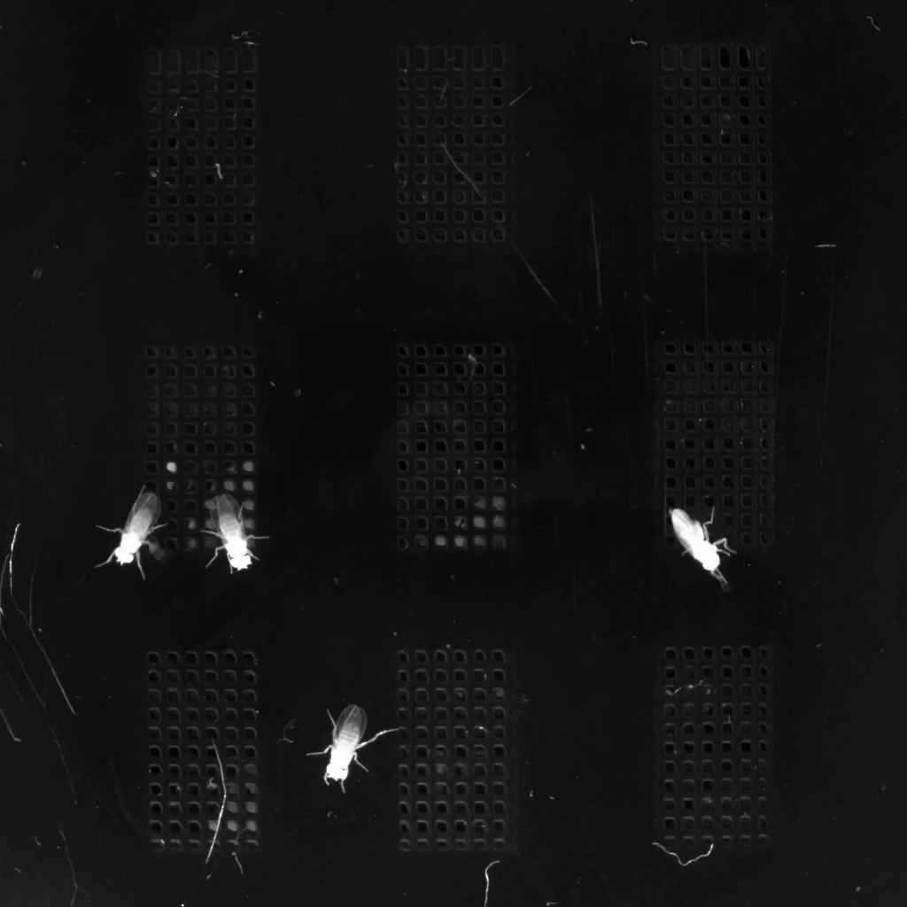
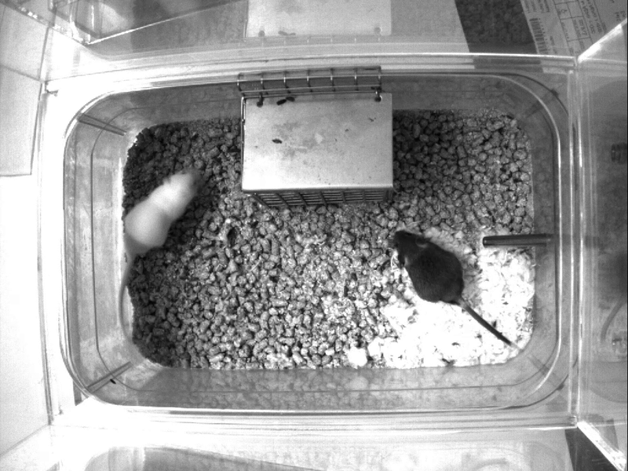
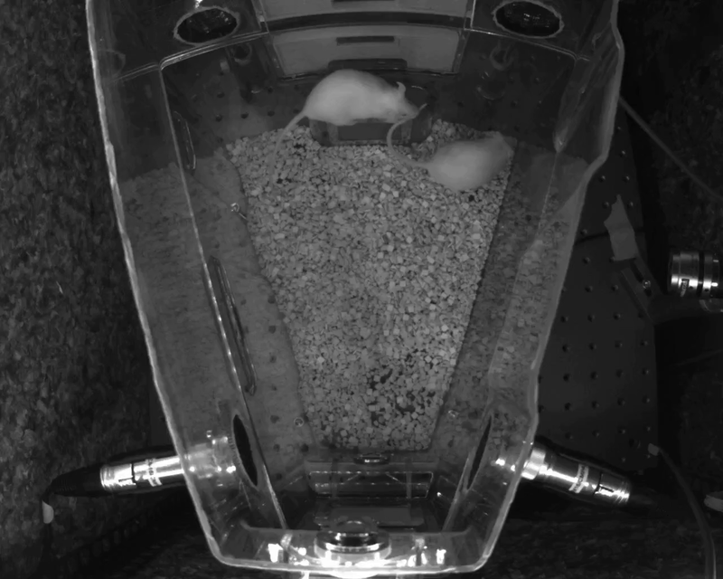
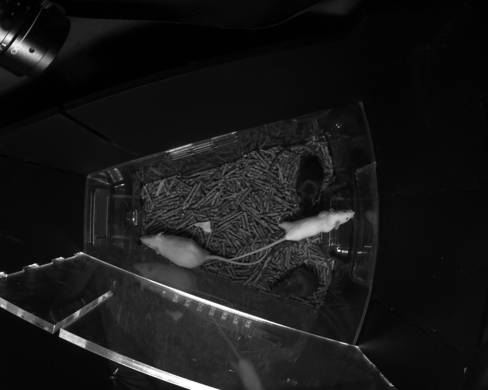
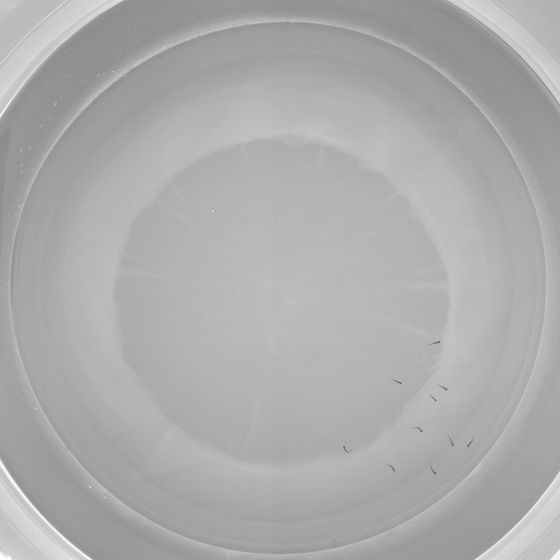
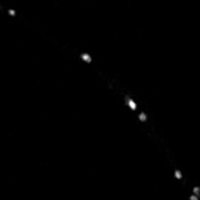
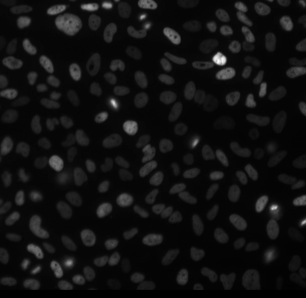
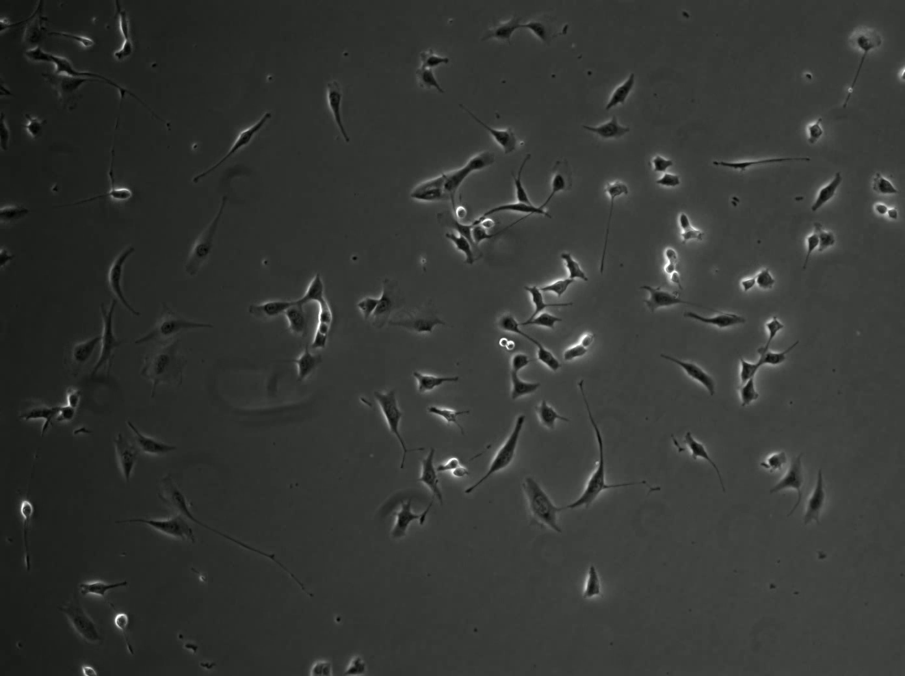
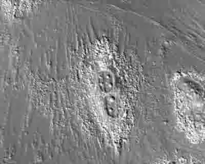

# Choosing Parameters

Load your detections (and your video, if you have it) and this page suggests `dreem track` settings for your data, with the reason for each. Everything runs in your browser: no file leaves your computer. Below the helper, [examples from the training datasets](#examples-from-the-training-datasets) show which settings suit which kind of data.

<link rel="stylesheet" href="../css/param-helper.css">

  

    <label>Detections or labels (.slp)
      <input id="ph-slp" type="file" accept=".slp,.h5,.hdf5">
      Pose keypoints or centroids, tracked or not.
    </label>
    <label>Video (optional)
      <input id="ph-video" type="file" accept="video/*,.mp4,.avi,.mov">
      Shows the suggested crops on a frame. Drag a box around one animal or cell to size the crop yourself.
    </label>
    <label>Cell masks (optional)
      <input id="ph-masks" type="file" accept=".tif,.tiff" multiple>
      Cell Tracking Challenge label TIFFs: one file per frame, or one stack.
    </label>
    <fieldset>
      What are you tracking?
      <label><input type="radio" name="ph-domain" value="animals"> Animals</label>
      <label><input type="radio" name="ph-domain" value="cells"> Cells</label>
      Picks the pretrained model; set from your data when it can tell.
    </fieldset>
    <label>Anchor
      <select id="ph-anchor" disabled>
        <option value="centroid">centroid (mean of visible keypoints)</option>
      </select>
      The point each crop is centred on.
    </label>
    

      <button id="ph-run" class="md-button md-button--primary" type="button">Suggest settings</button>
      <button id="ph-demo-animals" class="md-button" type="button">Try the flies demo</button>
      <button id="ph-demo-cells" class="md-button" type="button">Try the cells demo</button>
    

  

  
Choose a labels file, mask TIFFs or a video, or try a demo.

  <table>
    <thead><tr><th>Setting</th><th>Suggestion</th><th>Why</th></tr></thead>
    <tbody id="ph-results"></tbody>
  </table>

  

    <strong>Command</strong> <button id="ph-copy" type="button">Copy</button>
    <pre><code id="ph-command"></code></pre>
  

  

    

      <canvas id="ph-canvas" width="640" height="480" aria-label="A frame of your video with the suggested crop around each object"></canvas>
      

        <button id="ph-prev" type="button">Previous</button>
        <button id="ph-next" type="button">Next</button>
        <button id="ph-clear-box" type="button">Clear box</button>
        
      

    

    

  

## How the suggestions are made

| Setting | Suggested from | Leave it unset when |
|---|---|---|
| `--checkpoint` | Pose keypoints mean animals; masks mean cells. For centroid-only labels you choose. | - |
| `--crop-size` | The whole animal: the median size of the smallest square, centred on the anchor, that holds all of an instance's keypoints (or a cell's mask), rounded up to a multiple of 8. For centroid-only labels, the box you draw. | - |
| `--max-tracks` | The most common number of objects per frame, if it covers at least 90% of frames. | The number changes (cells entering, leaving or dividing), so new tracks must be able to start. |
| `--max-dist` | 1.5 times the 99th percentile of how far an object moves between consecutive frames. Taken from the tracks when the file has them; otherwise from pairing each detection with its nearest one in the next frame. A warning appears when objects move about half as far as they can be apart: then distance alone cannot tell them apart. | Fewer than 20 moves between consecutive labelled frames. |
| `--max-gap` | The 99th percentile of gaps in your tracks. | A fixed number of animals (tracks never need to end), or labels without tracks. |
| `--anchor` | `centroid`, the mean of the visible keypoints (DREEM's default), which always exists. You can pick a node instead. | - |
| `--front-node`, `--back-node`, `--max-angle` | Head- and tail-like node names (head, nose, snout... and tail, abdomen...); `--max-angle` is 1.5 times the 99th percentile of how far the body axis turns between consecutive frames, from tracked labels. | No such node names, or no tracks to measure turning from. |

These are starting points. Check the tracks in the [Live Visualizer](visualizer.md) and adjust: for example, raise `--max-dist` if fast animals lose their identity after a jump.

## Examples from the training datasets

What the helper suggests for the data the pretrained models were trained on, measured from a sample of each dataset's proofread labels (up to 4 videos and 3,000 frames each). "Closest spacing" is the 5th percentile of the distance from each object to its nearest neighbour; "moves" is the 99th percentile of movement between consecutive frames. The pretrained models were trained with smaller crops than these whole-animal sizes; that crop is listed for reference.

-   

    **[flies13](datasets.md#flies13)**: 2 to 8 flies, about 100 to 107 px long

    - Fixed number per video: `--max-tracks` = flies in the video
    - `--crop-size` 104 to 112
    - Moves 5 to 33 px, closest spacing 57 to 84 px: `--max-dist` 10 to 55. In the three-fly videos the flies move up to 33 px but can be 57 px apart, so distance alone is unreliable.
    - Pretrained crop: 64 (eight flies: 128)

-   

    **[mice_btc](datasets.md#mice_btc)**: 2 mice, about 273 px long

    - `--max-tracks 2`, `--crop-size 280`
    - Moves 35 px, closest spacing 79 px: `--max-dist 55`
    - Pretrained crop: 64

-   

    **[mice_hc](datasets.md#mice_hc)**: 2 mice, about 257 px long

    - `--max-tracks 2`, `--crop-size 264`
    - Moves 73 px, closest spacing 85 px: `--max-dist 110`, with the warning: a mouse can move more than half the distance to the other one in a frame, so distance alone cannot tell them apart.
    - Pretrained crop: 64

-   

    **[slap2m](datasets.md#slap2m)**: 1 to 4 mice, about 307 px long

    - Fixed number per video: `--max-tracks` = mice in the video
    - `--crop-size 312`
    - Moves 19 px, closest spacing 111 px: `--max-dist 30`
    - Pretrained crop: 90

-   

    **[zebrafish10](datasets.md#zebrafish10)**: 10 fish, centroid labels

    - `--max-tracks 10`; crop from a box drawn around one fish
    - Moves 28 px, closest spacing 56 px: `--max-dist 45`, with the warning (moves reach half the closest spacing).
    - Pretrained crop: 64

-   

    **[lysosomes](datasets.md#lysosomes)**: 1 to 8 per frame, centroid labels

    - The number changes: leave `--max-tracks` unset
    - Moves 9 px, closest spacing 8 px: `--max-dist 15`, with the warning: lysosomes can move further in a frame than they are apart.
    - Pretrained crop: 22

-   

    **[dynamicnuclearnet](datasets.md#dynamicnuclearnet)**: 3 to 249 nuclei, centroid labels

    - The number changes: leave `--max-tracks` unset
    - Moves 6 px, closest spacing 22 px: `--max-dist 10`
    - Pretrained crop: 32

-   

    **[phase_contrast](datasets.md#phase_contrast)**: 2 to 95 cells per frame, centroid labels

    - The number changes: leave `--max-tracks` unset
    - Moves 5 px, closest spacing 14 px: `--max-dist 10`
    - Pretrained crop: 42

-   

    **[motchallenge](datasets.md#motchallenge)**: up to 117 DIC cells, centroid labels

    - The number changes: leave `--max-tracks` unset
    - Moves 2 px, closest spacing 35 px: `--max-dist 5`
    - Pretrained crop: 100

